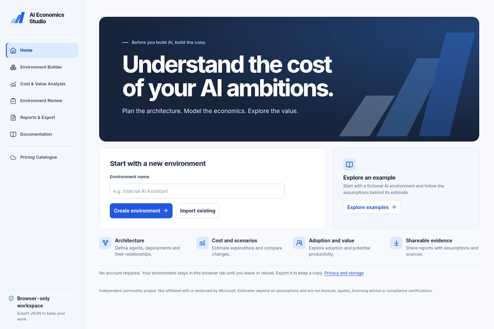
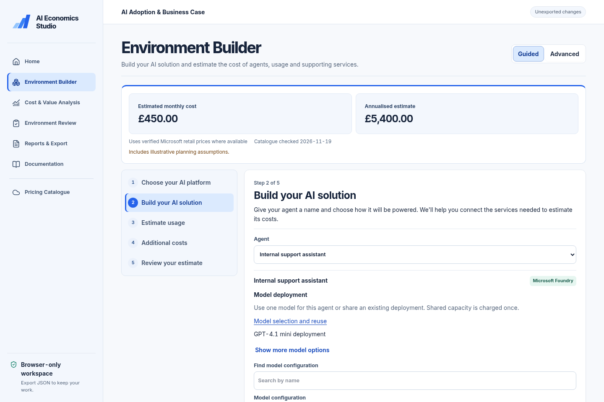
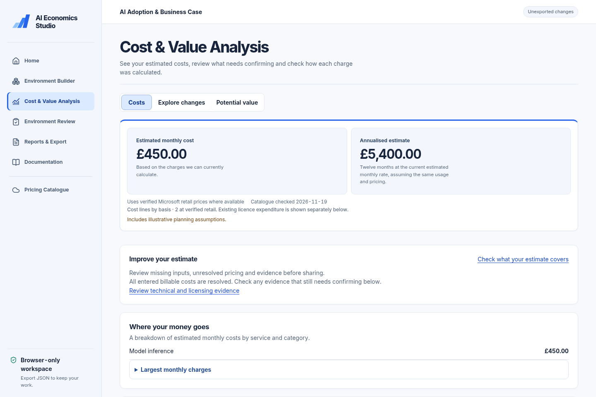
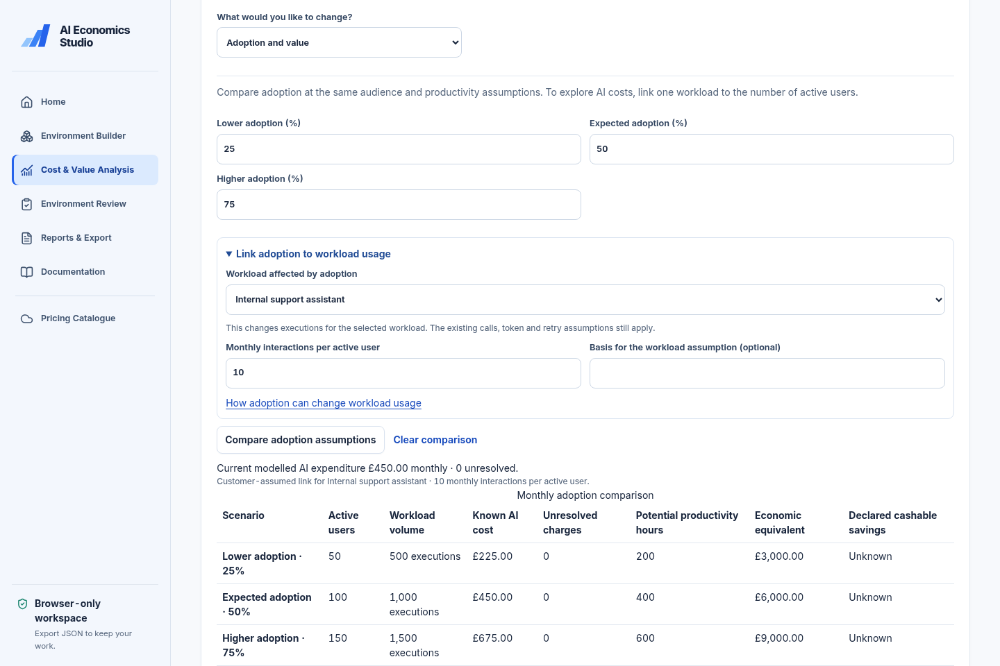
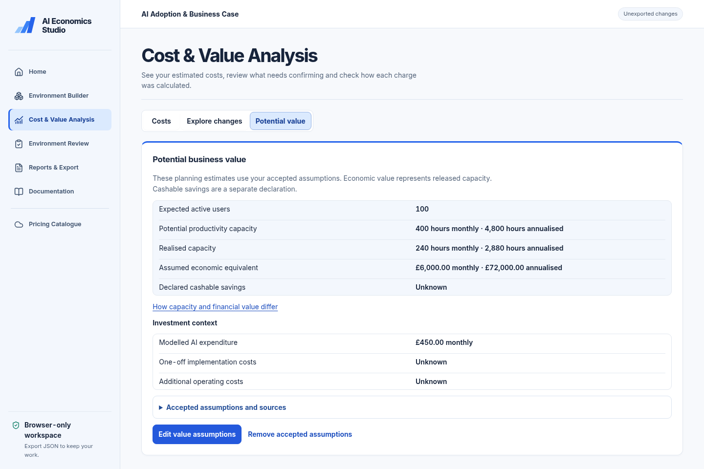
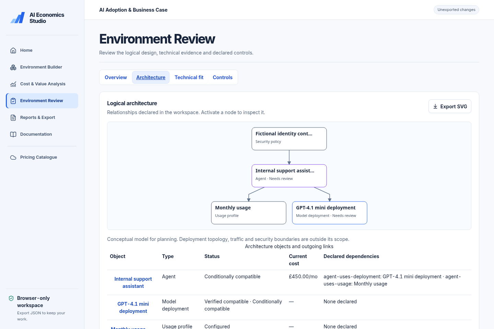
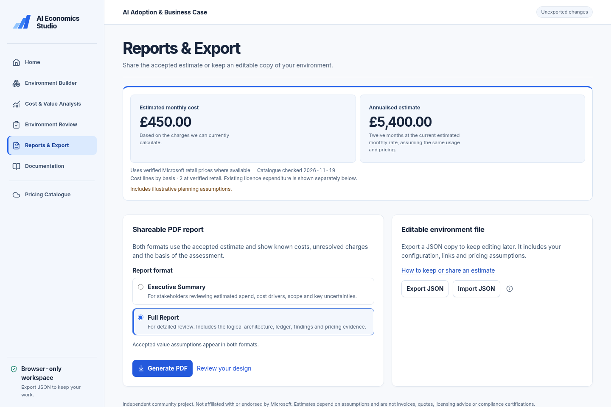

<p></p>

# AI Economics Studio

**Before you build AI, build the case.**

AI Economics Studio is an independent, open-source planning tool for Microsoft-first AI environments. Model the architecture, estimate expenditure, and compare adoption and potential value before implementation.

[Open the Studio](https://studio.ethan0wens.tech) · [User documentation](https://studio.ethan0wens.tech/#/documentation) · [MIT licence](LICENSE)



## What you can do

| Capability | What it helps you do |
| --- | --- |
| Environment Builder | Model platforms, agents, model deployments, supporting resources and licences. Use Guided or Advanced mode on the same environment. |
| Cost & Value Analysis | See estimated monthly and annualised expenditure using the available verified pricing and your assumptions. |
| Explore changes | Compare usage, price and adoption assumptions while preserving the accepted figures. |
| Potential value | Model adoption, time and productivity assumptions separately from expenditure and declared cashable savings. |
| Environment Review | Inspect the logical architecture, technical fit, evidence gaps and declared controls. |
| Reports & Export | Download a branded Executive Summary or Full Report PDF. Export editable JSON to keep the workspace. |
| Pricing Catalogue | Inspect coverage, provenance, currency, units and gaps for the published Microsoft catalogue. |

## A tour of the Studio

<details open>
<summary><strong>Build an environment and understand its cost</strong></summary>

Start with a guided checklist and see the monthly estimate update as you add information.



Review the known costs, unresolved inputs and the usage and pricing behind each charge.



</details>

<details>
<summary><strong>Compare changes and model adoption</strong></summary>

Compare alternative adoption levels. Link adoption to a specific workload when you want to see a projected expenditure change.



Review expected users, gross and realised time, and the economic equivalent. Declare cashable savings separately when you have evidence for them.



</details>

<details>
<summary><strong>Review the design and share your work</strong></summary>

Inspect the diagram and its object register alongside technical fit and evidence-based controls.



Select a branded PDF format and save a JSON copy to edit later. Your browser generates both downloads.



</details>

## A fictional business case

The AI Adoption & Business Case example models an internal support assistant. The accepted run-rate uses **pinned fictional rates**. The example leaves implementation and additional operating costs undeclared.

| Input or result | Fictional example |
| --- | ---: |
| Target users | 200 |
| Adoption | 50% |
| Active users | 100 |
| Tasks per active user per month | 20 |
| Minutes saved per task | 12 |
| Gross time equivalent | 400 hours monthly |
| Realisation factor | 60% |
| Realised time equivalent | 240 hours monthly |
| Hourly economic assumption | £25 |
| Economic equivalent | £6,000 monthly / £72,000 annualised |
| Accepted AI expenditure | £450 monthly / £5,400 annualised |
| Cashable savings | Undeclared |

Economic equivalent expresses the assumed value of productive time. A cashable saving requires a separate declaration. [Walkthrough](https://studio.ethan0wens.tech/#/documentation/example-ai-adoption-business-case) · [Independent reconciliation](docs/technical/03-worked-reconciliations.md#ai-adoption-and-business-case)

## Five editable examples

| Example | What it illustrates |
| --- | --- |
| [Basic Foundry Assistant](https://studio.ethan0wens.tech/#/examples/foundry-assistant) | Connect an assistant, usage profile and model deployment. |
| [Copilot Studio Business Agent](https://studio.ethan0wens.tech/#/examples/copilot-agent) | Declare Copilot credit usage and inspect the evidence behind its pricing. |
| [Enterprise AI Environment](https://studio.ethan0wens.tech/#/examples/enterprise-ai) | Review agents, deployed models, shared resources, licences and planned controls together. |
| [Shared Model Deployment](https://studio.ethan0wens.tech/#/examples/shared-deployment) | Allocate a shared deployment charge across agents while counting the commitment once. |
| [AI Adoption & Business Case](https://studio.ethan0wens.tech/#/examples/ai-adoption-business-case) | Compare expenditure and productivity under separately declared assumptions. |

## How estimates work

The ledger uses verified public retail rates where available. Explicit agreements can override or discount those rates, and forecasts stay separate from current expenditure. Estimates distinguish existing licence spend from incremental spend and allocate shared capacity once. The quantity, billing unit, currency and evidence determine each charge. Unknown costs stay unknown and appear alongside the known subtotal.

Adoption feeds a scenario’s expenditure only when you explicitly link it to a workload. The potential-value estimate uses separate time and realisation inputs. [Pricing and TCO methodology](docs/04-pricing-and-tco.md) · [Technical ledger reference](docs/technical/03-ledger-methodology.md) · [Pricing evidence](SOURCES.md)

## Privacy and hosting

Your browser holds the environment in memory, calculates results and generates reports. The Studio has no accounts, customer-data backend, automatic environment storage or application telemetry. Use JSON export and import to keep an editable copy. Cloudflare serves static assets, and GitHub Actions maintains the Microsoft catalogue separately from browser sessions. [Architecture](docs/technical/01-system-architecture.md) · [Security policy](SECURITY.md)

## Get started

1. Open [the Studio](https://studio.ethan0wens.tech), then load an example or name a new environment.
2. Add your agents, models and resources in Guided or Advanced mode. Supply usage and check evidence gaps as you go.
3. Review costs and explore changes. Use Environment Review to inspect the design and its controls.
4. Download a PDF for sharing and export JSON if you want to keep editing later.

### Run locally

Use Node.js 24 LTS and npm.

```sh
npm ci
npm run dev
```

Run the same validation as the pull request checks.

```sh
npm run security:audit
npm run typecheck
npm run lint
npm test
npm run build
npx playwright install chromium
STUDIO_CHECK_PUBLISHED_CATALOGUE=1 npm run test:e2e
```

The build validates documentation, catalogue data, Microsoft evidence and the production asset policy. See the [capture instructions](docs/assets/readme/README.md) to reproduce the screenshots.

## Reference and contributing

- [User guides](https://studio.ethan0wens.tech/#/documentation) and [field guide](docs/13-field-guide.md)
- [Technical documentation](docs/technical/README.md), [catalogue sources](SOURCES.md) and [operations](docs/12-operations.md)
- [Contributing](CONTRIBUTING.md), [reporting security issues](SECURITY.md) and [Economic Signal assets](design/brand/README.md)

## Limitations and independence

AI Economics Studio is independent of Microsoft. It focuses on Microsoft-first designs and applies the verified public evidence and inputs available to the workspace. Estimates are for planning. They carry no quotation, invoice, licensing certification or compliance certification. Coverage varies by billing dimension, region, eligibility and product. [Supported scope and gaps](docs/16-catalogue-scope-and-maintenance.md) · [Technical limitations](docs/technical/07-limitations.md)

## Licence

The Studio is available under the [MIT licence](LICENSE). The browser distribution carries [third-party notices](public/third-party-notices.txt), including the licences for its [bundled fonts](src/report-fonts/README.md).
