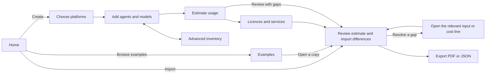

# Stage 1 · Information architecture and journeys

## Navigation

| Placement | Destination | Contents |
| --- | --- | --- |
| Primary | **Home** | Start or import an environment. Resume the current one. Browse examples as a secondary action. |
| Primary | **Environment Builder** | Guided or Advanced view of the current environment. Architecture and governance views are accessible here. |
| Primary | **Cost Analysis** | Known costs, estimate readiness, cost drivers, ledger and collapsed pricing assumptions. |
| Primary | **Reports & Export** | PDF, JSON, summary of limitations and architecture link. |
| Primary | **Documentation** | Searchable guides, examples, methodology, glossary and FAQs. |
| Secondary · Reference | **Pricing Catalogue** | Public pricing, coverage and health. Available before creating an environment. |

The brand links to Home. The main navigation is a list of links. The current environment appears with a labelled workspace menu for Rename, Settings, Duplicate and Start new, and a quiet **Changes to export** status when appropriate. Mobile uses the same order in a dismissible navigation panel. Give the active destination `aria-current`, provide a skip link and focus the destination heading after navigation. Builder, Cost Analysis and Reports each offer **Create an environment** and **Import existing environment** when opened without a workspace.

Use stable hash routes for the static SPA, such as `/#/builder`, `/#/costs`, `/#/reports`, `/#/examples`, `/#/catalogue` and `/#/documentation/<slug>`. Use `/#/documentation/<slug>?section=<anchor>` for a deep link to a stable heading, then scroll to and focus that heading. Browser Back and Forward restore the view. URLs carry only routes, article IDs and public reference IDs. Help and workspace links keep an in-memory return location so leaving for Documentation preserves an active edit context.

## Guided stages

| Stage | User question | Minimum action | Leave or skip |
| --- | --- | --- | --- |
| 1. Platforms | Where will your agents run? | Choose Microsoft Foundry, Copilot Studio or both as planning intent. Explain that they use different billing units. | Inspect any later stage, start in Advanced or leave the intent open. Selecting a platform creates no purchased items or assumed usage. |
| 2. Agents and models | What are you planning to run? | Name an agent and choose its platform. For a linked Foundry agent, choose or create a deployment. Copilot Studio uses the existing platform-managed path. | New agents can be drafts. Other stages and Cost Analysis remain available. |
| 3. Usage | How much will it run? | Enter run and token assumptions for each applicable Foundry workload, or monthly Copilot Credits. Conditional provisioned inputs are capacity and hours. | Review an example, apply an explicitly labelled usage preset or skip with an actionable gap. |
| 4. Licences and services | What else will you pay for? | Add evidenced licences and supporting services if relevant. Ask whether a licence is already owned or a new purchase. | **Skip for now** moves to Review. It records a session-only visit state and leaves any existing charges intact. |
| 5. Review and export | What can I defend in this estimate? | See known monthly and annual costs, the reason for any gaps and a direct action. Continue to Cost Analysis or generate a draft PDF. | Review at any time. Optional work can be revisited. |

Agents and their workloads are the organising concepts. User groups and supporting services can still be added earlier via Advanced or task-level shortcuts. Each step can be opened independently. Use **Needs input**, **Started**, **Ready to review** or **Skipped** when meaningful. A step’s state explains progress through inputs independently of verified pricing and technical evidence.

## Session and state transitions

- **First visit or reload.** Show Home with an empty name, Create, Import, three capability summaries and the privacy explanation. The session starts without a workspace. A refresh restores a public route if possible and opens workspace-only routes in their empty state.
- **Create.** Submit a non-empty trimmed name within the existing 300-character limit. Create a unique environment with the existing GBP and UK South defaults. Focus the Platforms heading and show the editable billing defaults at the next relevant point. First run opens Guided. The name is the sole required entry on Home.
- **Return to Home with a workspace.** Show the name, export status and **Resume environment** first. Resume restores the last workspace destination, object, mode and step when available in this tab. Home, Documentation and Catalogue preserve the active draft.
- **Import.** Read and validate JSON locally before considering replacement. An invalid file leaves the open environment, route and export state intact. Show a concise error near the action with expandable validation details, and allow selecting the same file again. A successful import opens Review, compares the source snapshot where present, and offers **Open Advanced builder** for full edits. Show prices recalculated against the applied catalogue, any unmapped item and the difference between saved and current known values when currency and scope match.
- **Rename.** Offer **Rename environment** with the current name filled in. Save updates the name, marks edits for JSON export and preserves the view and object IDs. Cancel leaves the original name. Enter submits and Escape dismisses. Rename applies to future file names and report headings.
- **Replace an environment.** New, Import, Duplicate and Open example use one guard if changes exist. For a valid incoming candidate show the current and incoming names where relevant. Offer **Keep editing**, **Export JSON first**, and **Replace environment**. Export first keeps the replacement pending until the user chooses Replace. Escape and closing the dialog cancel and restore focus to the initiating control. Cancelling retains the draft and position.
- **Save and close.** JSON download is the explicit save action. The app labels the state as exported when it hands the download to the browser. PDF is a shareable estimate. Edits after JSON export restore the changes indicator. Catalogue adoption shows “Estimate changed since export” when the applied basis changes. Warn on leaving a modified tab where the browser permits it. Explain reopening via JSON on every entry route that needs a workspace.
- **Switch mode or platform.** Guided and Advanced render the same validated environment. Switching view keeps open data and restores the active object when applicable. A deliberate platform edit on an existing agent previews consequences for active billing inputs, preserves recoverable data and uses the existing rules to prevent unsupported charging. Planning intent changes what setup suggests.
- **Resolve readiness.** Activate a row to focus a named field, relevant Advanced subsection, or exact ledger line and keep a return link. Where a finding has several fixes, show the affected object and its choices. Returning recomputes the ledger and keeps the viewed scope.

## Journey acceptance

| Journey | Acceptance |
| --- | --- |
| Blank to Foundry estimate | Create, plan one Foundry agent, create or reuse a model from the same step, add usage inline, review an explained priced subtotal or exact missing input, and download PDF. Advanced inventory is optional along this path. |
| Copilot and combined | Copilot’s first usage entry is credits with an explanation. Adding a Foundry agent reuses the workspace and exposes token usage only for that path. Shared deployments, allowances and prompts remain explicitly scoped. |
| Any-order draft | Create a resource or model before an agent, switch both ways between modes, resume after visiting Home, and verify all IDs, quantities and relationships are preserved. |
| Import, rename and replace | A valid historical JSON round-trips, recap compares catalogue snapshots, rename changes report and file names, invalid or cancelled import leaves prior state intact, and starting over prompts when appropriate. |
| Keyboard and mobile | At narrow widths and 200% zoom, use navigation and steps, edit a contextual input, open a help topic and return, and export. Back and Escape are predictable and focus remains visible. |
