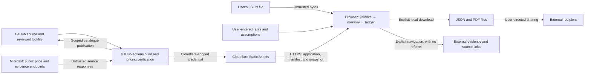

# Security threat model

Reviewed 19 November 2026 using STRIDE. Scope covers the browser, release infrastructure and pricing automation for the existing static Cloudflare Worker. The browser, GitHub and Cloudflare are distinct security boundaries.

## Assets and trust boundaries

| Boundary | Asset and trust decision | Control |
| --- | --- | --- |
| User and browser application | Environment data, rates, licences and costs are commercially sensitive. The delivered application and browser context have access to open data. | HTTPS, same-origin application resources, CSP, no customer data persistence, application-level uploads or telemetry. |
| File and validated objects | JSON bytes are wholly untrusted. An accepted file is a set of assumptions supplied by the user. | Byte, structural and schema limits, exact relationships, explicit replacement and recalculation. |
| Application and catalogue | Manifest and rates are conditionally trusted as public, publisher-controlled artefacts. | Same-origin delivery, exact schema and billing identities, checked byte digest and fallback. A compromised publisher could publish a different digest. |
| Microsoft and CI | External prices, availability, page continuations and text are untrusted until matched against reviewed sources. | TLS, approved hosts and paths, bounded redirects, timeouts, size limits and publication checks. |
| Source and Actions | Source and lockfile integrity protect build outputs and credentials. Pull-request content is untrusted. | Read-only PR jobs, pinned actions, lockfile and gate checks. Production and repository settings require owner verification. |
| Actions and Cloudflare | Scoped credentials and guarded publication protect the production Worker, verified assets and availability. | Production environment, account/Worker checks, serial promotion and verified rollback. Account scope and bypass roles require owner verification. |
| Files and recipients | Exported PDF and JSON leave application control. | Explicit browser download, inert report content and user-directed handling. |
| Browser and external evidence | External links leave the studio. External documents do not run as part of the application. | Exact allowed hosts, HTTPS, internal route validation and referrer isolation. |

## STRIDE assessment

| Threat | Realistic scenario | Existing or intended controls and residual risk |
| --- | --- | --- |
| Spoofing | External source or deployment target impersonation. | Approved source identities and exact Worker identity. Publisher/account takeover remains a trust dependency. |
| Tampering | Invalid input, altered snapshot, manipulated source data or workflow changes alter the cost ledger. | Strict schema, exact meter matching, content addressing, staged candidate validation and independent reconciliation. A valid hash is integrity evidence and does not authenticate a publisher. |
| Repudiation | A recipient assumes the public rate or estimate applies to their own agreement. | Source timestamps, review evidence, applied settings and a reproducible JSON/PDF. There is no user audit log. |
| Information disclosure | A script, external navigation or user sharing exposes customer assumptions. | Text rendering, restrictive CSP, referrer isolation, no application persistence or network transmission of environment state. Browser extensions, downloaded files and device sharing remain external. |
| Denial of service | Oversized input or source responses exhaust browser/CI memory. | Explicit limits before expensive parsing, graph bounds and timeouts. An unusually dense valid diagram or report can still be slow on low-powered devices. |
| Elevation of privilege | A pull request, upstream dependency or overprivileged workflow gains access to publish or use credentials. | Trigger separation, immutable action revisions and job-specific permissions. Repository protection and Cloudflare token scope are owner checks. |

The application exposes no customer authentication, server-side session or data store. Account takeover scenarios concern the publisher, browser and delivery infrastructure. Provider logs can retain normal request metadata, such as public path and IP address. They do not establish customer environment collection by the application.
